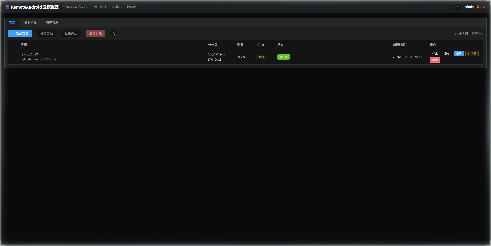
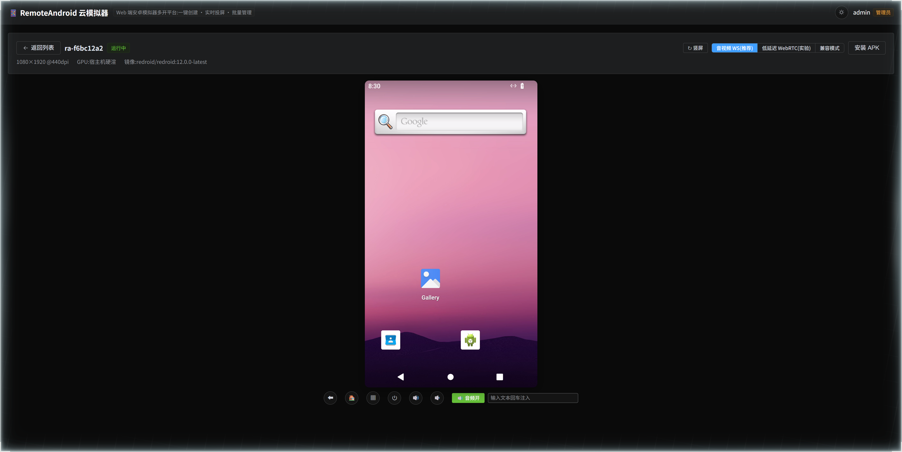
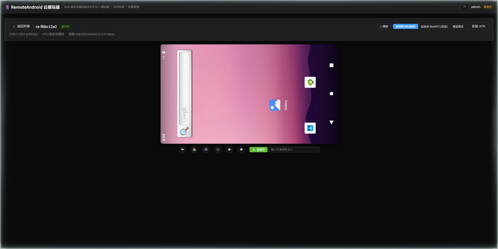
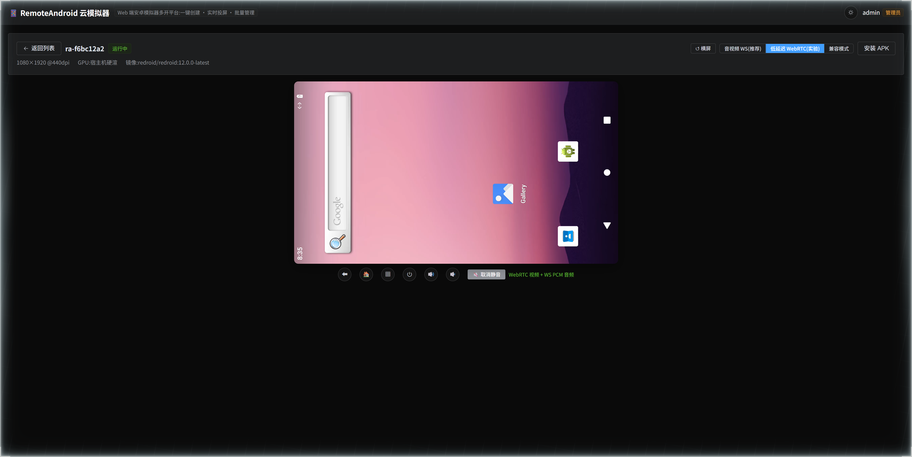

# RemoteAndroid — 云端安卓模拟器多开管理平台

在浏览器里创建、启动、停止、批量多开安卓模拟器实例:实时投屏 + 触控操作,支持宿主机 GPU 渲染,整套平台支持 Docker Compose 一键部署。

## 界面预览

真实运行截图(Docker + redroid 12 实例):

| 实例管理台(批量启动/停止/快照) | 竖屏投屏(WebCodecs 硬解 + 音频) |
|---|---|
|  |  |

| 横屏模式(一键旋转,视频跟随) | 低延迟 WebRTC 模式(实验,WHEP 播放) |
|---|---|
|  |  |

## 架构

```
浏览器 (Vue3 + WebCodecs 解码)
   │  REST /api/*        WebSocket /ws/stream/:id (H264 裸流 + 触控指令)
   ▼
API 服务 (Node.js + Express + ws + dockerode + adb + SQLite)
   │  Docker Socket 编排           adb 通道 (scrcpy-server 推流/控制)
   ▼
Docker 宿主机 (Linux + KVM + GPU)
   ├─ redroid 实例 #1  (Android 12, GPU host 渲染)
   ├─ redroid 实例 #2
   └─ redroid 实例 #N  ← 多开 = 多容器
```

- 模拟器内核:[redroid](https://github.com/remote-android/redroid-doc)(容器化 Android,原生支持 GPU 直通)
- 投屏链路:scrcpy-server(H264)→ WebSocket → 浏览器 WebCodecs 硬解码,延迟 50~100ms
- 触控链路:浏览器鼠标/键盘事件 → WebSocket JSON → 后端转 scrcpy 控制协议注入

## 目录结构

```
RemoteAndroid/
├── docker-compose.yml      # 一键部署:web + api
├── .env.example
├── scripts/
│   └── load-kernel-modules.sh   # 宿主机 binder/ashmem 内核模块
├── server/                 # 后端:实例编排 + 推流网关
│   ├── src/
│   │   ├── index.ts        # 入口(HTTP + WS + 状态同步)
│   │   ├── config.ts
│   │   ├── db.ts           # SQLite 实例台账
│   │   ├── docker.ts       # redroid 容器生命周期
│   │   ├── adb.ts          # adb CLI 封装
│   │   ├── scrcpy.ts       # scrcpy-server 部署 + H264 帧解析 + 控制协议
│   │   ├── ws.ts           # /ws/stream/:id 推流+触控网关
│   │   └── routes.ts       # REST API
│   └── Dockerfile          # node20 + adb + scrcpy-server.jar
└── web/                    # 前端:Vue3 + Element Plus
    ├── src/
    │   ├── views/Dashboard.vue   # 实例列表/创建/批量操作
    │   ├── views/Detail.vue      # 投屏详情页
    │   ├── components/Player.vue # WebCodecs 播放器 + 触控注入
    │   └── player/h264.ts        # AnnexB→AVCC、avcC 构建
    └── Dockerfile          # 构建 → nginx(反代 /api 与 /ws)
```

## 快速开始(生产部署,Linux 宿主机)

前置条件:

- Linux 宿主机(推荐 Ubuntu 22.04+,内核 ≥ 5.10),已安装 Docker + Docker Compose 插件
- 内核 binder/ashmem 模块:`sudo bash scripts/load-kernel-modules.sh`
- GPU 硬渲染(可选):Intel/AMD 装好 Mesa,确认 `/dev/dri` 存在;NVIDIA 装 nvidia-container-toolkit

```bash
cp .env.example .env        # 按需修改 redroid 镜像、GPU 设备等
docker compose up -d --build
# 打开 http://<宿主机IP>/  → 创建实例 → 点击"投屏"
```

> 首次创建实例会拉取 redroid 镜像(约 1~2GB),耗时取决于网络。

## 发布到飞牛 NAS(`npm run publish`)

与 game-server-admin 完全相同的离线发布流程(`scripts/publish.js`):

1. 本地 Docker 构建 `remote-android-api` + `remote-android-web` 两个镜像
2. `docker save` 合并打包成 tar.gz
3. SFTP 上传到 NAS 的 `/vol1/1000/Docker/RemoteAndroid`
4. NAS 上 `docker load` + `docker compose up -d`(自动 sudo)
5. 版本号 `version.txt` 自动 +1,附赠 NAS 内核 binder 模块检查

```bash
# 首次:复制并填写 NAS 信息(本项目已按 game-server-admin 同配置填好)
copy publish.config.example.js publish.config.js

npm install        # 装根目录依赖(ssh2)
npm run publish    # 一键发布
```

不启动 Docker Desktop 也能发布:构建用哪台 Docker 引擎由 `scripts/docker-engine.js` 按
**本机 dockerd → WSL 发行版里的 Docker Engine → 自动启动 Docker Desktop** 的顺序挑选。
在 WSL 里装一次引擎即可(装完 Docker Desktop 可以一直不开):

```bash
npm run setup:wsl-docker          # 默认 Ubuntu-24.04;可加 `-- Debian` 指定发行版
```

`publish.config.js` 里可用 `docker: 'auto' | 'desktop' | 'wsl'` 强制指定引擎,
`wslDistro` / `wslUser`(默认 root)指定 WSL 发行版与执行用户。

发布后**单端口双协议**(8443,nginx stream 层 TLS 嗅探分流):

| 入口 | 说明 |
|---|---|
| `http://<NAS-IP>:8443` | HTTP:视频自动降级 WASM 软解(Broadway),帧率略低 |
| `https://<NAS-IP>:8443` | HTTPS(容器启动时自签证书,CN/SAN=NAS IP,持久化在 `RemoteAndroid/certs/`):浏览器点"高级→继续前往"信任一次即可,WebCodecs 硬解 + AudioWorklet 全开,体验接近桌面模拟器 |

NAS 侧目录结构:

```
/vol1/1000/Docker/RemoteAndroid/
├── docker-compose.yml       # 发布时生成({{IMAGE_*}} 已替换为版本号)
├── load-kernel-modules.sh   # 内核模块加载脚本(发布时上传)
└── data/                    # SQLite 实例台账(持久化)
```

工具脚本:`node scripts/nas-check.js` 可随时检查 NAS 的内核 binder 模块状态。

> ✅ **已验证**:fnOS 内核(6.18.18.c1107-trim)把 binder **编译进内核**(非模块),`/dev/binder`、`/dev/binderfs` 开箱就有,redroid 实例可正常启动、投屏。
> ✅ NAS 的 Docker 已配好国内镜像加速器(发布脚本不依赖,但 NAS 自行拉镜像时需要)。
> ⚠️ 在 NAS 上重启 docker 服务后,`ra-api` 容器内的 `docker.sock` 挂载会失效,需要 `docker restart ra-api` 一次。

## 免构建:直接下载 Release 镜像

推送 `v*` tag 后,GitHub Actions 会自动构建 `api` / `web` 镜像并发布到 [Releases](../../releases):

| 产物 | 说明 |
|---|---|
| `remote-android-{api,web}-<tag>-amd64.tar.gz` | 离线镜像包,`docker load -i` 加载后直接使用 |
| `docker-compose.release.yml` | 已引用上述镜像 tag 的 compose 文件,与镜像包放同一目录即可 |

```bash
# 以 v0.0.66 为例:下载镜像包 + docker-compose.release.yml 后
docker load -i remote-android-api-v0.0.66-amd64.tar.gz
docker load -i remote-android-web-v0.0.66-amd64.tar.gz
docker compose -f docker-compose.release.yml up -d
```

网络可达 ghcr.io 的话,也可以直接拉取(支持 linux/amd64、linux/arm64):

```bash
docker pull ghcr.io/mingxuanzi/remote-android/api:v0.0.66
docker pull ghcr.io/mingxuanzi/remote-android/web:v0.0.66
```

## 本机开发

```bash
# 后端(需要能访问 Docker;Windows 下 Docker Desktop 即可调通 API,
# 但 redroid 容器本身需要 Linux/WSL2 环境才能真正跑起来)
cd server && npm install && npm run dev        # http://localhost:8080

# 前端
cd web && npm install && npm run dev           # http://localhost:5173(已配置代理)
```

### Windows / WSL2 说明

- **管理端(API/Web)在 Windows 上开发没有问题**,dockerode 通过 `npipe:////./pipe/docker_engine` 连接 Docker Desktop。
- **redroid 实例运行依赖 Linux 内核 binder 模块**:WSL2 默认内核不带 binder,需要使用自定义内核或 `CONFIG_ANDROID_BINDERFS` 开启后重编译。生产一律部署到裸 Linux。
- WSL2 下 GPU 硬渲染不可用(只能 SwiftShader 软渲染),所以正式多开密度测试请在 Linux 物理机进行。

## GPU 模式

创建实例时可选:

| 模式 | 说明 |
|---|---|
| `host` | 宿主机硬件 GPU 渲染(挂载 `/dev/dri`),流畅度接近真机/桌面模拟器 |
| `guest` | SwiftShader 纯 CPU 软渲染,无需任何 GPU,兼容性最好但帧率低 |

多实例共享同一块 GPU,密度瓶颈主要在显存与编码器。

## REST API

| 方法 | 路径 | 说明 |
|---|---|---|
| GET | `/api/instances` | 实例列表(含 Docker 实时状态) |
| POST | `/api/instances` | 创建实例 `{name?, width, height, dpi, gpuMode, count}`(count>1 即批量多开) |
| POST | `/api/instances/:id/start` `/stop` `/restart` | 单实例操作 |
| POST | `/api/instances/batch` | 批量 `{action: start\|stop\|delete, ids: []}` |
| POST | `/api/instances/:id/install` | 上传 APK 并 `adb install`(multipart) |
| DELETE | `/api/instances/:id` | 删除实例(连容器) |
| GET | `/api/config` | 平台配置(镜像、GPU 设备、码率等) |
| WS | `/ws/stream/:id` | H264 视频流(下行二进制) + 触控指令(上行 JSON) |

## 路线图(M 阶段)

- [x] M1 实例编排 CRUD + Compose 部署
- [x] M2 scrcpy WebSocket 推流 + WebCodecs 解码 + 触控注入
- [x] M3 GPU 直通参数 + 批量多开 + APK 安装
- [x] M4 快照克隆(docker commit 模板化)+ JWT 鉴权与用户配额 + 音频转发 + WebRTC 低延迟流
  - 三种播放模式:**低延迟 WebRTC**(默认,scrcpy 2.4 → 自研 JS RTP 打包/RTSP 发布 → MediaMTX WHEP,静态画面 IDR 重放保活)、**音视频 WS**(scrcpy 2.4 视频+PCM 音频全走 WebSocket)、**兼容模式**(scrcpy 1.25,老链路)
  - 音频统一走 WS PCM + AudioWorklet/ScriptProcessor 双路径
